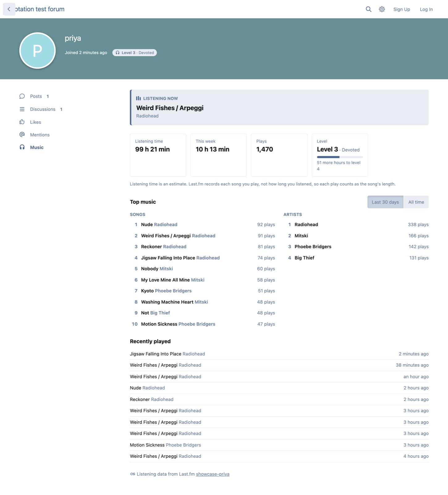
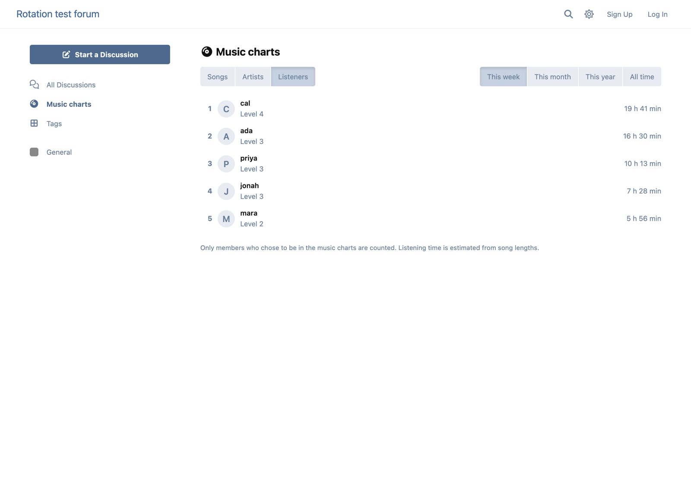
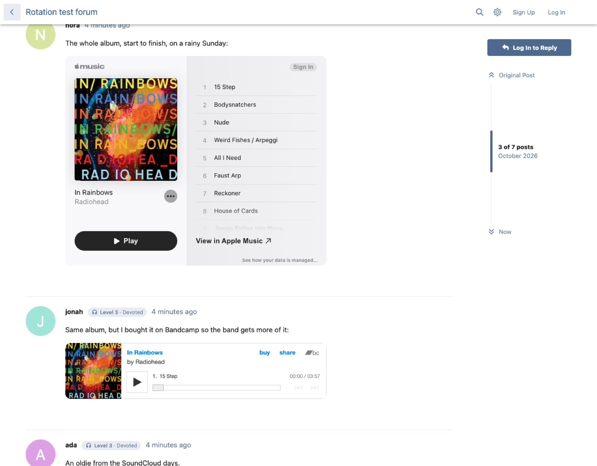
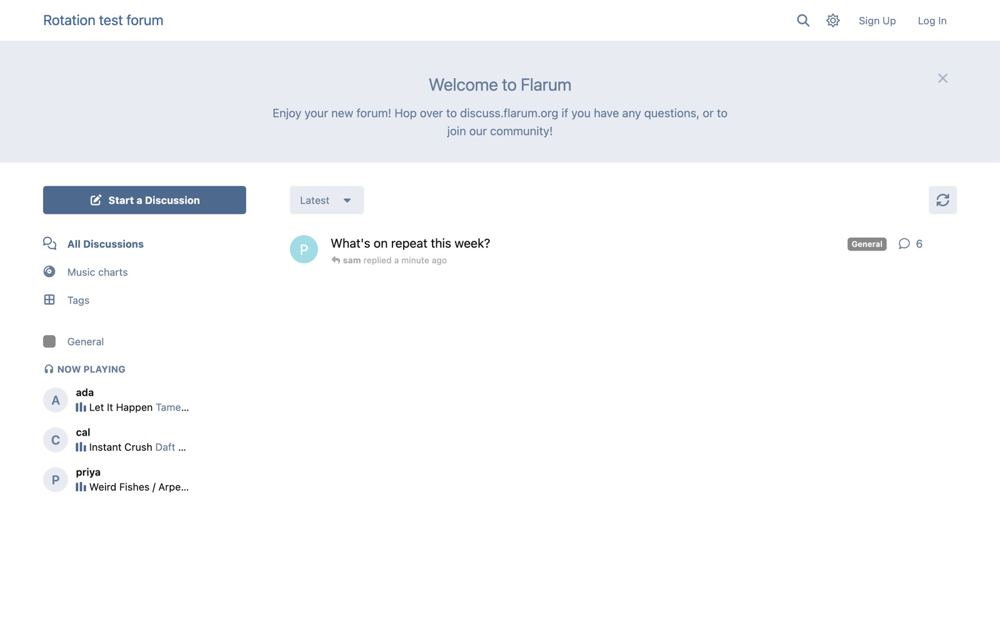
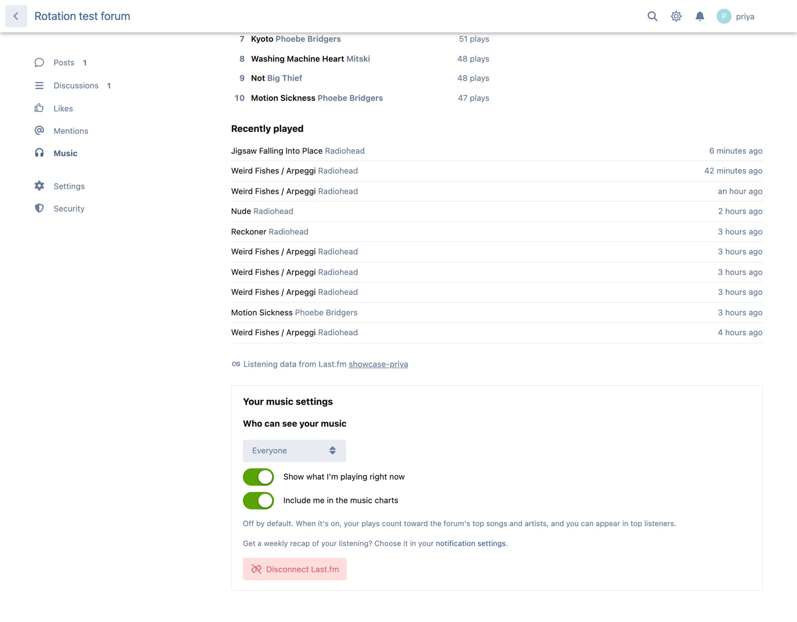
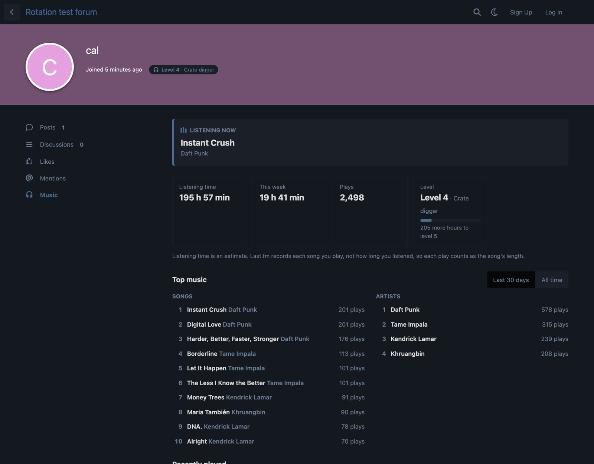
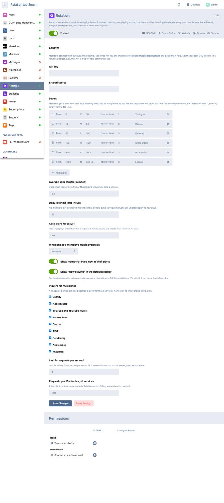

# Rotation

 [](https://packagist.org/packages/ernestdefoe/rotation)

Members' music listening for [Flarum](https://flarum.org) 2. Free and MIT licensed.

Members connect their own **Last.fm** account. Spotify sends plays to Last.fm through a built-in connection. Apple Music and YouTube Music need a scrobbler: an app on the phone or Mac, or the Web Scrobbler browser extension, which also covers SoundCloud, Bandcamp and other web players. Apple Music has no built-in Last.fm connection and no usable API for listening history, so a scrobbler is the only way to include it.



## Features

- **Music tab on profiles**: what the member is playing now, listening time, plays this week, top songs and artists (last 30 days and all time) and recently played.
- **Privacy per member**: who can see their music (everyone, signed-in members, only them), a switch for "now playing", and an opt-in for the charts (off by default).
- **Levels from listening time**: the admin sets bands, such as "from 10 to 50 hours = level 2 · Regular", as many as they want, dragged into order. Levels show on the profile, the user card and next to posts.
- **Music charts** at `/rotation`: top songs, artists and listeners for this week, month, year or all time. Only members who opted in are counted.
- **Widgets** for Bespoke and FoF Forum Widgets: Now playing, Top songs, Top artists, Top listeners. FoF widgets show only where you place them. Without either, "Now playing" can sit in the default sidebar.
- **Players for music links**: a Spotify, Apple Music, YouTube / YouTube Music, SoundCloud, Deezer, TIDAL, Bandcamp, Audiomack or Mixcloud link pasted on its own line becomes a player. Works with Flarum's editor, Markdown and Scribe.
- **Weekly recap**: "Your week in music", as a notification and optionally an email. Members turn it on or off in their notification settings.
- **GDPR**: with `flarum/gdpr`, listening data is in the member's export and is erased with their account. Disconnecting deletes it straight away.

## Screenshots

| | |
|---|---|
|  |  |
|  |  |
|  |  |

## How listening time works

Last.fm records each song a member plays, not how long they listened. Rotation counts each play as the song's length: from Last.fm, else from MusicBrainz, else the admin's average (3.5 minutes by default). Lengths are looked up once per song. A daily limit (16 hours by default) stops fake plays from pushing anyone up, and plays timestamped in the future or more than 14 days late are ignored.

## Installation

```sh
composer require ernestdefoe/rotation
php flarum migrate
php flarum cache:clear
```

Then:

1. Get a free API key and shared secret at [last.fm/api/account/create](https://www.last.fm/api/account/create). Set the callback URL to your forum's address.
2. Paste both into **Admin → Rotation**.
3. Make sure Flarum's scheduler runs every minute (`* * * * * php /path/to/flarum schedule:run`). Rotation fetches plays in the background and never calls Last.fm while a page loads.

## Updating

```sh
composer update ernestdefoe/rotation
php flarum migrate
php flarum cache:clear
```

## Requests and limits

Everything runs from the scheduler, inside a strict budget:

- Last.fm: 1 request per second by default (Last.fm allows 5 per server IP; keep it low if several forums share a server).
- MusicBrainz: under 1 request per second, and only for songs Last.fm has no length for.
- A cap on all requests per 10 minutes (300 by default).
- Members are checked every few minutes while they're playing something, less often once they go quiet, and once a day after 30 days away.

Rotation stores no tokens: Last.fm's sign-in proves which account a member owns, and their plays are public reads.

## Content Security Policy

If your forum sends a `frame-src` policy, allow: `open.spotify.com`, `embed.music.apple.com`, `www.youtube-nocookie.com`, `w.soundcloud.com`, `widget.deezer.com`, `embed.tidal.com`, `bandcamp.com`, `audiomack.com`, `player-widget.mixcloud.com`.

## Links

- [Source](https://github.com/ernestdefoe/rotation)
- [Report an issue](https://github.com/ernestdefoe/rotation/issues)
- ☕ [Buy me a coffee](https://buymeacoffee.com/ernestdefoe)
